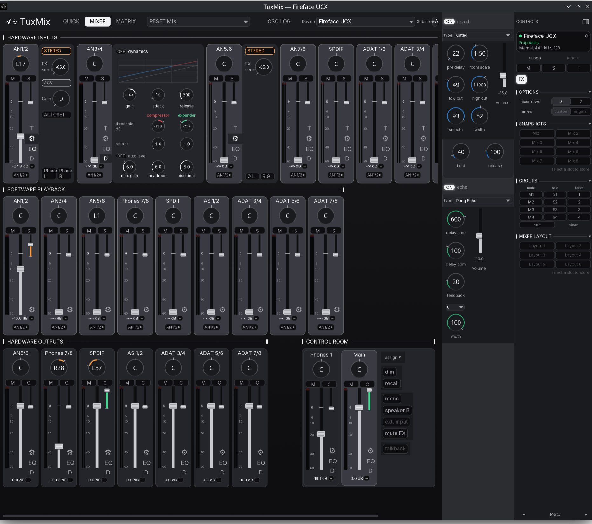

# TuxMix and the Fireface driver for Linux

Native Linux support for the RME Fireface UC and UCX in normal RME vendor
mode: a kernel transport module (`snd-fireface-uc`) and the TuxMix mixer.

This tree is based on [TuxMix](https://github.com/ismail-bahloul/TuxMix) by
Ismaïl Bahloul — his Babyface Pro FS mixer — and extends it into a full
control surface for the Fireface UC family.  His commit history is preserved
in this repository.



## Functionality

- **Fireface UC and Fireface UCX support.**  The `snd-fireface-uc` kernel
  module provides the vendor-mode USB transport, the ALSA PCM device, a
  `snd-hwdep` control ABI and per-unit identification by serial.
- **Seamless sample-rate switching.**  The rate follows the session without
  a reconnect, and the transport stays stable at the high rates — 192 kHz
  included — down to buffer sizes of 96 samples.
- **MIDI in and out over USB.**  A standard rawmidi port on the unit's
  second USB interface; works with any Linux sequencer or DAW.
- **Full OSC support.**  The complete RME OSC dialect: per-channel
  parameters, streamed meter peaks and remote control of the whole mixer
  and control room from any OSC client.
- **A much improved GUI.**  Near-complete mixer and Control Room
  functionality, with channel strips that slide their panels in and out —
  EQ, dynamics, sends and settings live next to their own strip.

## Architecture

The kernel module is a transport core:

- USB enumeration and per-device descriptors;
- alternate-setting and sample-rate selection;
- interrupt and isochronous URB engines;
- the ALSA PCM device;
- one `snd-hwdep` control node per card.

TuxMix owns the device model: matrix routing, faders, preamps, EQ/dynamics,
meters, clock/options and scenes.  The model and connection are deliberately
separate: a backend reports its capabilities, and the GUI only shows controls
that connection can actually drive.

- `kernel/` — the kernel transport module.
- `ui/tuxmix/` — TuxMix core, GUI and TUI.
- `docs/spec/` — authoritative, present-tense specifications.

## Devices

| Device | USB ID | Audio transport |
|---|---|---|
| Fireface UC PC | `0424:3fc5` | interrupt IF0 |
| Fireface UC AP | `0424:3fc6`, `2a39:3fc6` | isochronous IF0 |
| Fireface UCX | `0424:3fc9`, `2a39:3fc9` | isochronous IF0 (default) or interrupt IF5 |

The UCX uses the isochronous interface by default (`ucx_if5=0`); set
`ucx_if5=1` for the interrupt interface.  The UC uses the personality selected
on the unit (PC or AP).

Normal RME mode uses RME's vendor protocol.  Class Compliant mode uses UAC2
and the host class driver; the unit's stored mixer controls routing.

One module instance handles several units.  TuxMix identifies each unit by
its serial number, remembers the selected unit across restarts, and opens that
exact unit again after a reconnect.  Scene files are kept per unit, including
two units of the same model.

## Quick start

```sh
./scripts/build-kernel.sh
./scripts/reload-kernel.sh

cd ui/tuxmix
cargo run -p tuxmix-core --example fireface-scan --features alsa
cargo run -p tuxmix-gui
```

`aplay -l` lists the cards and `ls -l /dev/snd/hwC*D*` lists the control nodes.
The kernel exposes no ALSA mixer controls; TuxMix uses the hwdep node.

The WirePlumber rule in `ui/tuxmix/tools/alsa/wireplumber-uc.conf` selects the
18-channel Pro Audio profile and keeps ALSA scheduling polled.  Install it as
`~/.config/wireplumber/wireplumber.conf.d/60-fireface-uc.conf` and restart
WirePlumber.

## Kernel updates

Install the module through DKMS once:

```sh
./scripts/install-dkms.sh
```

The installer registers the source in `/usr/src/snd-fireface-uc-0.1`, builds
it for the running kernel, and installs and enables
`snd-fireface-uc-load.service`.  On Fedora, the kernel package's
`40-dkms.install` hook rebuilds the module for each new kernel.  No dnf plugin
or path watcher is needed.  Keep `kernel-devel` installed; the boot unit loads
the module after DKMS at the next boot.

Check the result with:

```sh
dkms status
modinfo -k "$(uname -r)" snd-fireface-uc
```

If a new kernel was installed without matching headers:

```sh
sudo dnf install kernel-devel-"$(uname -r)"
sudo dkms autoinstall -k "$(uname -r)"
sudo modprobe snd-fireface-uc
```

`scripts/install-kernel.sh` is a compatibility wrapper for the DKMS installer.

Before a sample-rate, channel-count or transport change, run the 48 kHz gate:

```sh
cd ui/tuxmix
cargo build -p tuxmix-core --example fireface-ctl --features alsa
cd ../..
scripts/ffuc-48k-gate.sh all
```

## Documentation

- [Specification index](docs/spec/README.md)
- [UC control specification](docs/spec/UC-CONTROL-SPEC.md) — requests, matrix
  words, phase, output levels and state ownership.
- [UCX control specification](docs/spec/UCX-CONTROL-SPEC.md) — IF1 registers,
  matrix, output order, metering, implemented features and guards.
- [TuxMix control surface](docs/spec/TUXMIX-SPEC.md) — layout, controls,
  motion, latency and persistence.
- [Documentation index](docs/README.md) — reference and archived material.

The measured latency chain is documented in
[TUXMIX-SPEC.md §8](docs/spec/TUXMIX-SPEC.md#8-latency-chain).

## Current scope

- UC PC and AP transports.
- UCX isochronous and interrupt transports.
- Matrix, masters, mutes, pan, loopback, preamps, EQ/dynamics, clock and
  meters.
- Several cards, including identical models, selected by serial.
- Class Compliant cards through stock ALSA/PipeWire.
- Babyface Pro FS through the inherited ALSA and direct-USB backends.
- TuxMix GUI and TUI over the hwdep backend.

The UCX backend hides capabilities whose register or write path is not
implemented: per-cell mono matrix editing, output balance, phantom power, PAD,
pitch, width, MS processing and AN 1>2.  These are absent by design rather
than controls that silently do nothing.

## License

This project is free software: you can redistribute it and/or modify it under
the terms of the **GNU General Public License, version 3 or later**.  See
[LICENSE](LICENSE).  The kernel module is additionally marked
GPL-2.0-or-later so it remains compatible with the kernel and with later GPL
versions.

TuxMix and its third-party components retain their own notices in
[ui/tuxmix/LICENSE](ui/tuxmix/LICENSE).  The combined project is distributed
under GPL-3.0-or-later.

## Credits and attribution

This tree is based on [TuxMix](https://github.com/ismail-bahloul/TuxMix) by
Ismaïl Bahloul, at his release 0.3.1.  From that project we inherited the
mixer application, its device model, the Babyface Pro FS support (the ALSA
and direct-USB backends in `ui/tuxmix/tuxmix-usb`), the TUI and the scene
system.  TuxMix is MIT licensed; the license and copyright notice are kept
in [ui/tuxmix/LICENSE](ui/tuxmix/LICENSE), and his commit history is part of
this repository.

The Fireface UC/UCX kernel module, the OSC layer, the GUI's mixer and
Control Room extensions and the Fireface backends were developed in this
tree.  All Fireface protocol knowledge comes from our own USB captures; no
RME documentation or code is included.

